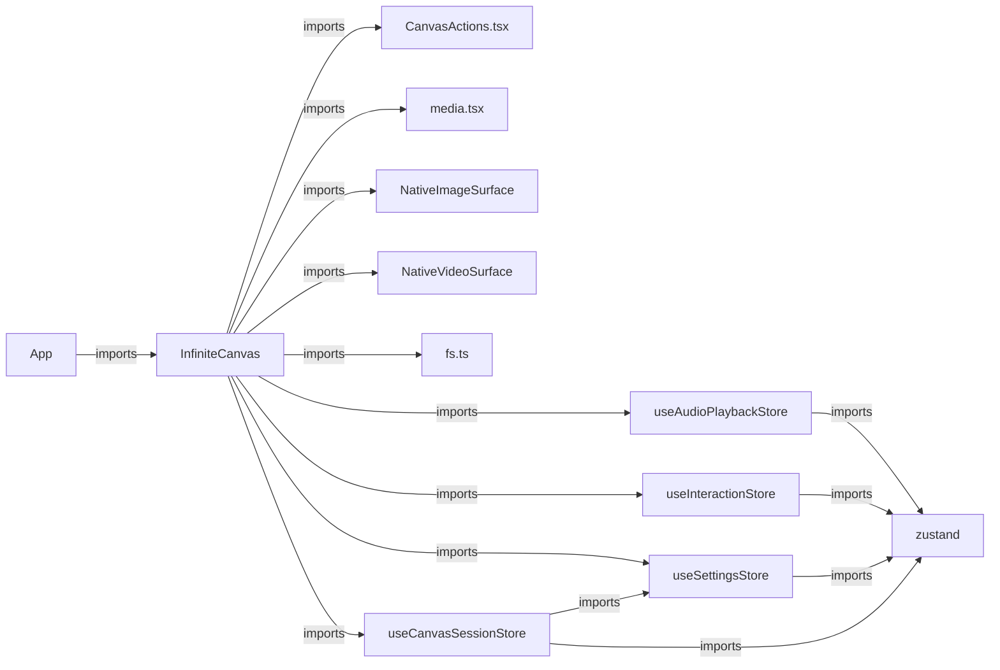

# React and Zustand

<!-- Generated by pnpm architecture:generate -->

Solid arrows show verified source relationships. Dotted arrows show declared relationships.

[Architecture overview](overview.md)
