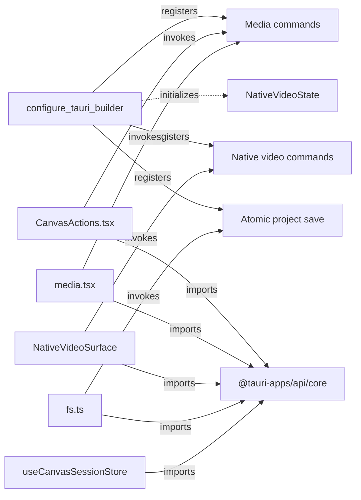

# Tauri IPC

<!-- Generated by pnpm architecture:generate -->

Solid arrows show verified source relationships. Dotted arrows show declared relationships.

## IPC commands

- `configure_tauri_builder` → `Media commands` (registers) — `clear_media_cache`, `export_video`, `generate_image_preview`, `generate_video_thumbnail`, `media_cache_stats`, `probe_images`, `probe_media`, `request_decode`, `save_media_screenshot`
- `configure_tauri_builder` → `Native video commands` (registers) — `native_video_get_profile`, `native_video_record_frontend_metrics`, `native_video_reset_profile`, `native_video_run_base_case_probe`, `native_video_stop_all`, `native_video_subscribe_frames`, `native_video_subscribe_telemetry`, `native_video_update_manifest`
- `configure_tauri_builder` → `Atomic project save` (registers) — `save_canvas_atomic`
- `CanvasActions.tsx` → `Media commands` (invokes) — `probe_images`, `probe_media`
- `media.tsx` → `Media commands` (invokes) — `export_video`, `generate_image_preview`, `generate_video_thumbnail`, `request_decode`, `save_media_screenshot`
- `NativeVideoSurface` → `Native video commands` (invokes) — `native_video_get_profile`, `native_video_record_frontend_metrics`, `native_video_run_base_case_probe`, `native_video_stop_all`, `native_video_subscribe_frames`, `native_video_subscribe_telemetry`, `native_video_update_manifest`
- `fs.ts` → `Atomic project save` (invokes) — `save_canvas_atomic`

[Architecture overview](overview.md)
