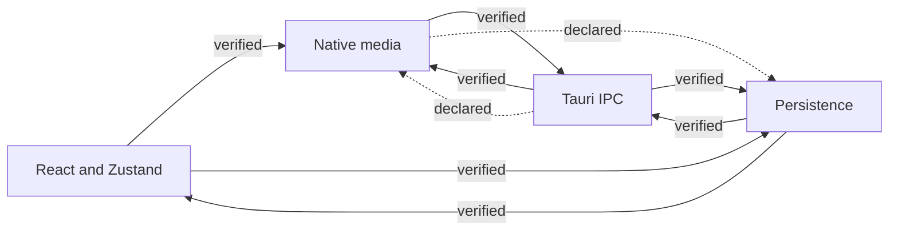

# Sigma architecture

<!-- Generated by pnpm architecture:generate -->

Solid arrows show verified source relationships. Dotted arrows show declared relationships.

- [React and Zustand](canvas.md)
- [Tauri IPC](ipc.md)
- [Native media](media.md)
- [Persistence](persistence.md)
- [Canonical graph](graph.json)
- [Agent context](agent-context.json)
- [Maintenance and scope](README.md)
