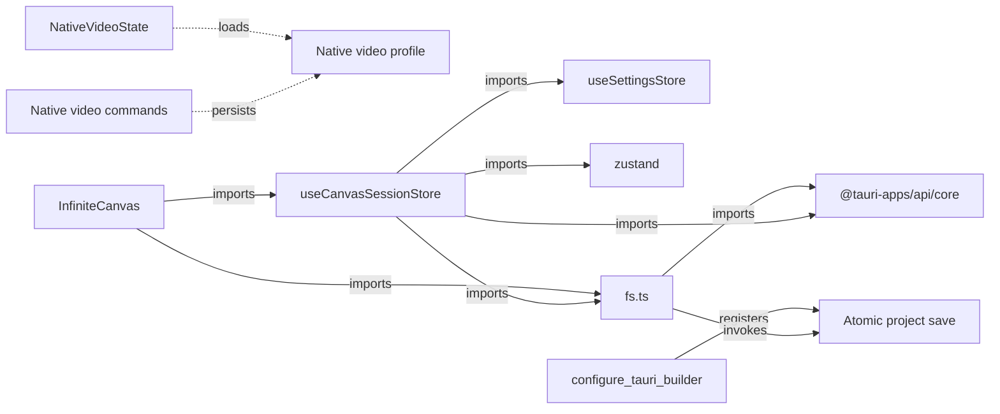

# Persistence

<!-- Generated by pnpm architecture:generate -->

Solid arrows show verified source relationships. Dotted arrows show declared relationships.

## IPC commands

- `configure_tauri_builder` → `Atomic project save` (registers) — `save_canvas_atomic`
- `fs.ts` → `Atomic project save` (invokes) — `save_canvas_atomic`

[Architecture overview](overview.md)
